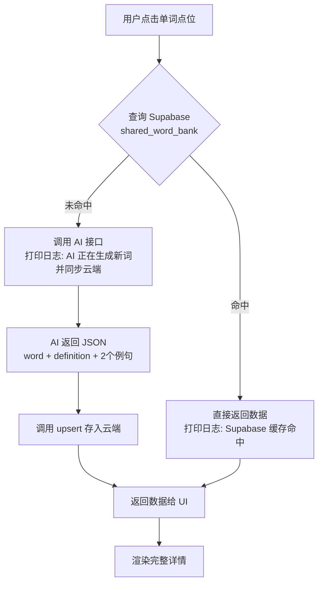
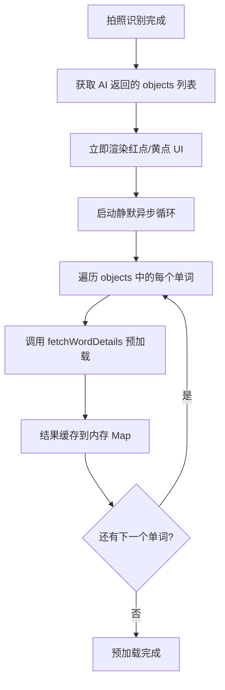
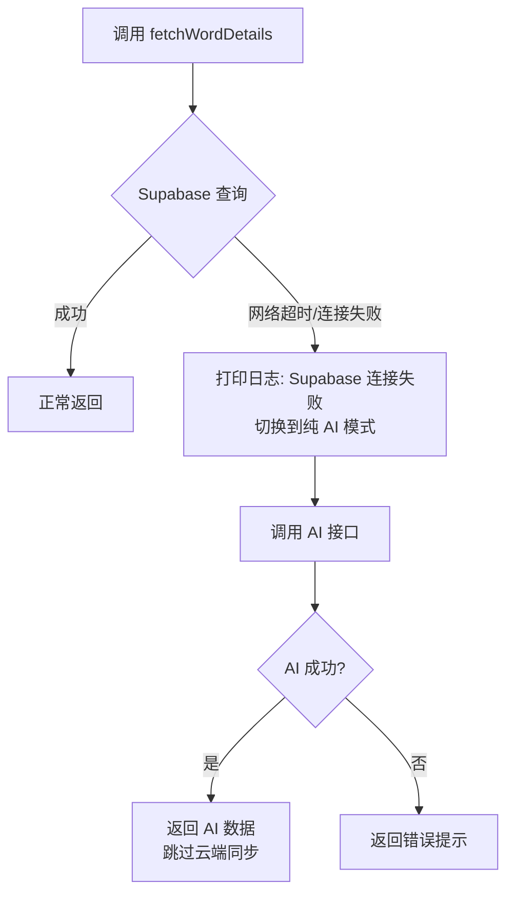
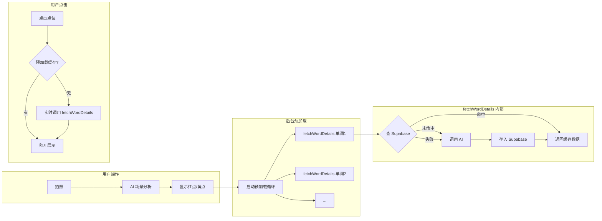

# 全球共享词库 + 异步预加载实施计划

## 概述

基于已配置的 Supabase 建立全球共享词库（`shared_word_bank`），重构单词详情获取流程，实现异步后台预加载机制，优化用户体验。

---

## 1. 数据表结构更新

### 当前问题

现有 [`services/supabaseClient.ts`](../services/supabaseClient.ts:8) 的 `SharedWordBank` 接口只定义了 5 个字段（`id`, `word`, `phonetic`, `definition`, `example_en`, `example_cn`），且只支持单条例句。

### 目标结构

```typescript
export interface SharedWordBank {
  id?: string;
  word: string;           // 主键，小写
  definition: string;     // 中文释义/翻译
  example_en_1: string;   // 英文例句 1
  example_cn_1: string;   // 中文翻译 1
  example_en_2: string;   // 英文例句 2
  example_cn_2: string;   // 中文翻译 2
  created_at?: string;
  updated_at?: string;
}
```

### 修改文件

| 文件 | 变更 |
|------|------|
| [`services/supabaseClient.ts`](../services/supabaseClient.ts) | 更新 `SharedWordBank` 接口定义 |
| [`services/wordBankService.ts`](../services/wordBankService.ts) | 重写 `fetchWordFromBank` 和 `upsertWordToBank`，适配新字段 |

---

## 2. 重构 fetchWordDetails 函数

### 逻辑流程



### 关键约束

- **命中缓存时严禁调用 AI 接口**
- AI Prompt 要求返回固定 JSON 格式
- AI 生成成功后立即 `upsert` 到 Supabase

### 修改文件

| 文件 | 变更 |
|------|------|
| [`services/aiService.js`](../services/aiService.js) | 新增 `fetchWordDetails(word, apiKey)` 函数，替代现有的 `fetchPhrasesForObject` |
| [`services/wordBankService.ts`](../services/wordBankService.ts) | 重写查询和写入函数 |

### 新增函数签名

```typescript
// services/aiService.js
export async function fetchWordDetails(word, apiKey) {
  // 1. 查云端
  // 2. 命中 → 直接返回
  // 3. 未命中 → AI 生成 → upsert → 返回
}
```

### AI Prompt 设计

```
你是一个英语词典专家。请为单词 "${word}" 提供：
1. 中文翻译（definition）
2. 两个不同语境的地道英语口语例句，每个例句附带中文翻译

必须返回纯 JSON 格式（不要 Markdown 标记）：
{
  "word": "${word}",
  "definition": "中文翻译",
  "example_en_1": "第一个英文例句",
  "example_cn_1": "第一个中文翻译",
  "example_en_2": "第二个英文例句",
  "example_cn_2": "第二个中文翻译"
}
```

---

## 3. 异步后台预加载

### 触发时机

在 [`app/camera.tsx`](../app/camera.tsx) 中，当 `handleAnalyzeScene` 完成 AI 场景分析后，**立即**启动预加载循环。

### 执行流程



### 缓存机制

使用 `Map<string, WordDetailData>` 作为内存缓存，键为单词小写，值为完整的单词详情数据。

```typescript
interface WordDetailData {
  word: string;
  definition: string;
  example_en_1: string;
  example_cn_1: string;
  example_en_2: string;
  example_cn_2: string;
}
```

### 修改文件

| 文件 | 变更 |
|------|------|
| [`app/camera.tsx`](../app/camera.tsx) | 在 `handleAnalyzeScene` 中添加预加载逻辑；在 `handleAnchorPress` 中优先检查预加载缓存 |

---

## 4. UI 展示调整

### 单词详情弹窗（DetailCard）

当前 [`app/camera.tsx`](../app/camera.tsx) 中的 `DetailCard` 组件只展示单词、翻译和例句列表。需要调整为：

- 单词（word）
- 中文释义（definition）
- 例句 1 + 翻译 1（example_en_1 / example_cn_1）
- 例句 2 + 翻译 2（example_en_2 / example_cn_2）

### 单词详情页（word-detail.tsx）

当前 [`app/word-detail.tsx`](../app/word-detail.tsx) 的 `WordDetailScreen` 通过路由参数接收数据。需要确保：

- 从相机点击点位跳转时，能传递完整的 6 个字段
- 页面展示：单词、释义、例句1+翻译1、例句2+翻译2

### 修改文件

| 文件 | 变更 |
|------|------|
| [`app/camera.tsx`](../app/camera.tsx) | 更新 `DetailCard` 组件展示结构 |
| [`app/word-detail.tsx`](../app/word-detail.tsx) | 更新路由参数和展示逻辑 |

---

## 5. 错误处理与降级

### 降级策略



### 日志规范

| 场景 | 控制台日志 |
|------|-----------|
| Supabase 命中 | `✅ Supabase 缓存命中: ${word}` |
| AI 生成新词 | `🤖 AI 正在生成新词并同步云端: ${word}` |
| Supabase 失败降级 | `⚠️ Supabase 连接失败，切换到纯 AI 模式: ${error.message}` |
| 云端同步成功 | `✅ 单词 "${word}" 成功存入云端词库` |

### 修改文件

| 文件 | 变更 |
|------|------|
| [`services/wordBankService.ts`](../services/wordBankService.ts) | 添加错误分类和降级标记 |
| [`services/aiService.js`](../services/aiService.js) | 在 `fetchWordDetails` 中处理降级逻辑 |

---

## 实施步骤清单

### 步骤 1：更新 Supabase 数据表接口

**涉及文件：**
- [`services/supabaseClient.ts`](../services/supabaseClient.ts) — 更新 `SharedWordBank` 接口
- [`services/wordBankService.ts`](../services/wordBankService.ts) — 重写查询和写入函数

**具体变更：**
1. 修改 `SharedWordBank` 接口，替换为 6 个核心字段
2. 重写 `fetchWordFromBank(word)`：查询 `shared_word_bank` 表，返回新结构
3. 重写 `upsertWordToBank(...)`：接收 6 个字段，执行 upsert

### 步骤 2：重构 fetchWordDetails 函数

**涉及文件：**
- [`services/aiService.js`](../services/aiService.js) — 新增 `fetchWordDetails` 函数

**具体变更：**
1. 新增 `fetchWordDetails(word, apiKey)` 函数
2. 内部调用 `fetchWordFromBank` 查云端
3. 命中 → 打印日志 → 直接返回
4. 未命中 → 调用 AI（新 Prompt）→ upsert → 返回
5. 错误降级：Supabase 失败时直接走 AI

### 步骤 3：实现异步后台预加载

**涉及文件：**
- [`app/camera.tsx`](../app/camera.tsx) — 添加预加载逻辑

**具体变更：**
1. 在 `handleAnalyzeScene` 中，AI 分析完成后启动预加载
2. 创建 `preloadWordDetails` 异步函数，遍历 objects 列表
3. 预加载结果存入 `Map<string, WordDetailData>` 缓存
4. 在 `handleAnchorPress` 中优先检查预加载缓存

### 步骤 4：调整 UI 展示

**涉及文件：**
- [`app/camera.tsx`](../app/camera.tsx) — 更新 DetailCard
- [`app/word-detail.tsx`](../app/word-detail.tsx) — 更新详情页

**具体变更：**
1. DetailCard 展示：单词 + 释义 + 例句1+翻译1 + 例句2+翻译2
2. WordDetailScreen 接收新路由参数并展示完整信息

### 步骤 5：错误处理与降级

**涉及文件：**
- [`services/wordBankService.ts`](../services/wordBankService.ts) — 错误分类
- [`services/aiService.js`](../services/aiService.js) — 降级逻辑

**具体变更：**
1. Supabase 查询失败时抛出可识别的错误类型
2. `fetchWordDetails` 捕获错误后自动降级到 AI 模式
3. 所有关键路径添加规范日志

---

## 数据流总览


